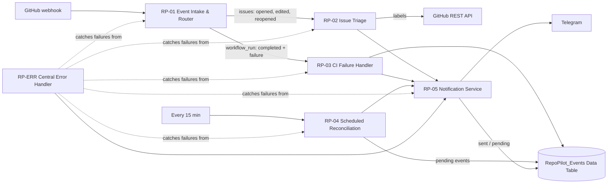
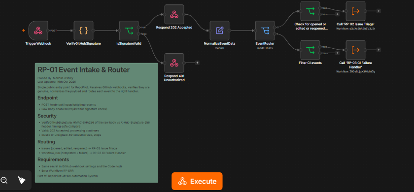
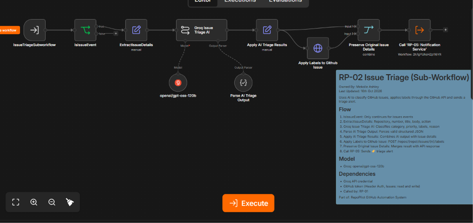
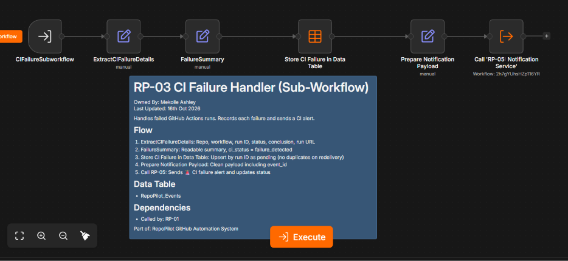
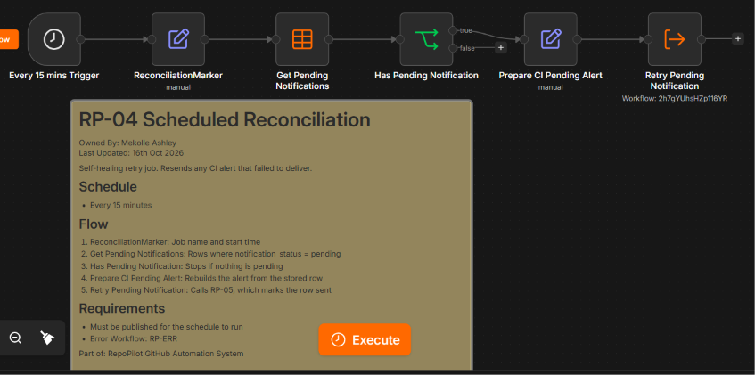
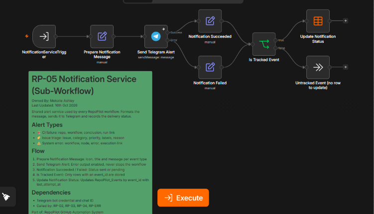
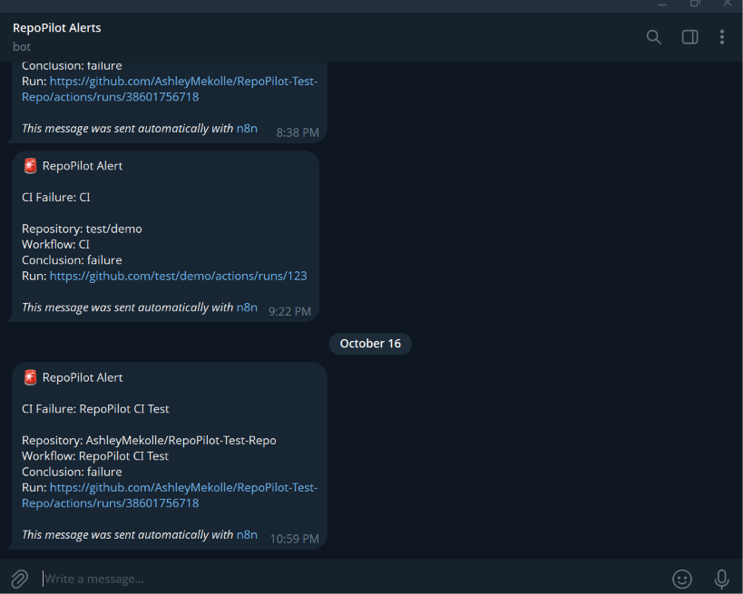

# RepoPilot

An event-driven GitHub automation system built in n8n. RepoPilot receives signed GitHub webhooks, uses AI to triage new issues and apply labels automatically, catches failed CI runs, and sends every alert to Telegram. Alert delivery is tracked in a Data Table and retried automatically, and a central error workflow reports any failure in the system to Telegram.

Built after completing the [n8n Academy Foundations program](https://github.com/AshleyMekolle/n8n-academy-foundations), as a real-world application of webhooks, sub-workflows, AI chains, Data Tables and error handling.

## What it does

| When this happens on GitHub | RepoPilot does this |
|---|---|
| Any request hits the webhook | The GitHub HMAC-SHA256 signature is verified, and anything unsigned or tampered with is rejected with `401` |
| An issue is opened, edited or reopened | AI classifies the category and priority, applies labels through the GitHub API, and sends a 🏷️ triage alert to Telegram with the AI's reasoning |
| A GitHub Actions run completes with a failure | Records the failure in a Data Table and sends a 🚨 Telegram alert with a link to the failed run |
| A Telegram alert fails to send | The event stays `pending` in the Data Table, and a scheduled job retries it every 15 minutes until it is marked `sent` |
| Any RepoPilot workflow fails | The central error workflow sends a ⚠️ Telegram alert with the workflow, failed node, error message and execution link |

## Architecture

The system is split into one entry point, three handlers and one shared notification service, so each workflow has one job. New event types can be added as a new route in RP-01 and a new handler, without changing the rest.

## Workflows

### RP-01 Event Intake & Router
The single public entry point. A Webhook node receives GitHub events at `POST /webhook/repopilot/github-events` and keeps the raw request body.

**Signature verification:** a Code node calculates an HMAC-SHA256 of the raw body with the shared webhook secret and compares it with GitHub's `X-Hub-Signature-256` header using a timing-safe comparison. Valid requests get an immediate `202 Accepted`, which keeps GitHub within its 10-second delivery timeout while processing continues. Invalid or unsigned requests get `401 Unauthorized` and go no further. The check runs on the raw bytes because re-serializing parsed JSON does not reproduce GitHub's exact payload.

Edit Fields then normalizes the payload into one consistent shape (`event_type`, `event_action`, `repository`, issue fields and `workflow_run`), reading the event type from the `X-GitHub-Event` header. A Switch node then routes each event:

- `issues` events go on only when the action is `opened`, `edited` or `reopened`, then to RP-02.
- `workflow_run` events go on only when the run is `completed` with conclusion `failure`, then to RP-03.

**Nodes:** Webhook (raw body), Code, IF (x3), Respond to Webhook (202 and 401), Edit Fields (Set), Switch, Execute Workflow (x2)

### RP-02 Issue Triage (sub-workflow)
1. Extracts the issue number, title, body and action.
2. **AI classification:** a Basic LLM Chain running `openai/gpt-oss-120b` on Groq acts as a triage assistant. It returns a category (`bug`, `feature`, `documentation`, `needs-review`), a priority (`high`, `medium`, `low`), a list of labels and a one-sentence reason. Clear priority rules are in the prompt: security risks, data loss and outages are high, functional bugs are medium, and features and docs are low. The model is told to use `needs-review` rather than guess when an issue is unclear.
3. A Structured Output Parser makes sure the result is valid JSON that later nodes can rely on.
4. **Labels:** an authenticated request to the GitHub REST API (`POST /repos/{owner}/{repo}/issues/{number}/labels`) applies the suggested labels to the issue.
5. A Merge node combines the triage result with the API response, and the result is passed to RP-05.

**Nodes:** Execute Workflow Trigger, IF, Edit Fields (Set) (x2), Basic LLM Chain, Groq Chat Model, Structured Output Parser, HTTP Request, Merge, Execute Workflow

### RP-03 CI Failure Handler (sub-workflow)
Extracts the repository, workflow name, run ID, status, conclusion and run URL, and builds a readable failure summary. The failure is upserted into the `RepoPilot_Events` Data Table with `notification_status: pending`, keyed on the run ID so a redelivered webhook cannot create a duplicate. It then builds a clean notification payload, including the `event_id`, and calls RP-05.

**Nodes:** Execute Workflow Trigger, Edit Fields (Set) (x3), Data Table (upsert), Execute Workflow

### RP-04 Scheduled Reconciliation
Runs every 15 minutes. It reads every event in the Data Table that is still `pending`, rebuilds the alert and sends it through RP-05 again, which marks the row `sent` once it is delivered. This makes alert delivery self-healing: if Telegram is down, the alert goes out on the next run, and each alert is sent only once after it succeeds.

**Nodes:** Schedule Trigger, Edit Fields (Set) (x2), Data Table (get), IF, Execute Workflow

### RP-05 Notification Service (sub-workflow)
A shared service that every workflow uses to send alerts, so message formatting and delivery live in one place. It builds an icon, title and message for three event types:

- 🚨 **CI failure:** repository, workflow, conclusion and run link
- 🏷️ **Issue triage:** issue, category, priority, labels and the AI's reasoning
- ⚠️ **System error:** failed workflow, node, error message and execution link

After sending to Telegram, it records the outcome. The Telegram node uses an error output, so a failed send becomes `pending` instead of stopping the workflow. For events tracked in the Data Table, the row is updated by `event_id` to `sent` or `pending` with a `last_attempt_at` timestamp, which is what RP-04 uses to decide what to retry.

**Nodes:** Execute Workflow Trigger, Edit Fields (Set) (x3), Telegram, IF, Data Table (update), No Operation

### RP-ERR Central Error Handler
Set as the Error Workflow for every RepoPilot workflow. When any of them fails in production, it captures the failed workflow's name, the node that failed, the error message, the execution link and the time, then sends a ⚠️ alert through RP-05. If the failure came from RP-05 itself, the alert is skipped, which prevents an infinite error loop.

**Nodes:** Error Trigger, Edit Fields (Set), IF, Execute Workflow, No Operation

## Screenshots

| | |
|---|---|
|  |  |
|  |  |
|  |  |

## Setup

1. **Credentials in n8n:**
   - Groq API
   - Telegram bot
   - Header Auth for GitHub, with name `Authorization` and value `Bearer YOUR_GITHUB_TOKEN`. Use a fine-grained token with **Issues: Read and write** on the target repos.
2. **Webhook secret:** generate a random secret, for example with `node -e "console.log(require('crypto').randomBytes(32).toString('hex'))"`. In RP-01's `VerifyGitHubSignature` node, replace `YOUR_GITHUB_WEBHOOK_SECRET` with it.
3. **Data Table:** create `RepoPilot_Events` with the columns `event_id`, `repository`, `workflow_name`, `run_url`, `conclusion`, `notification_status`, `created_at` and `last_attempt_at`.
4. **Import the workflows** in this order: RP-ERR, RP-05, RP-02, RP-03, RP-04, then RP-01. Reselect the sub-workflows in each Execute Workflow node, and set RP-ERR as the Error Workflow in each workflow's settings.
5. In RP-05, replace `YOUR_TELEGRAM_CHAT_ID` with your Telegram chat ID.
6. **GitHub webhook:** in the repository, go to **Settings**, then **Webhooks**, then **Add webhook**:
   - **Payload URL:** `https://YOUR_INSTANCE.app.n8n.cloud/webhook/repopilot/github-events`
   - **Content type:** `application/json`
   - **Secret:** the same secret as in step 2
   - **Events:** Issues and Workflow runs
7. Publish all the workflows, including RP-04, then open an issue or push a failing commit to test. To confirm the security check, send an unsigned request to the webhook URL with `curl`. It should return `401`.

## Roadmap

- [x] Webhook signature verification (HMAC-SHA256)
- [x] Telegram alerts for issue triage, CI failures and system errors
- [x] Delivery status tracking with automatic retries
- [ ] Post the AI's triage reason as a comment on the issue
- [ ] Cap retries and flag events that keep failing to deliver
- [ ] Move the webhook secret into n8n Variables

## Tech

n8n Cloud, GitHub Webhooks and REST API, Groq (`openai/gpt-oss-120b`), Telegram Bot API, n8n Data Tables

## Author

**Mekolle Ashley** | Automation & Back-End Developer
[GitHub](https://github.com/AshleyMekolle) | Mekolleashleyam@gmail.com
