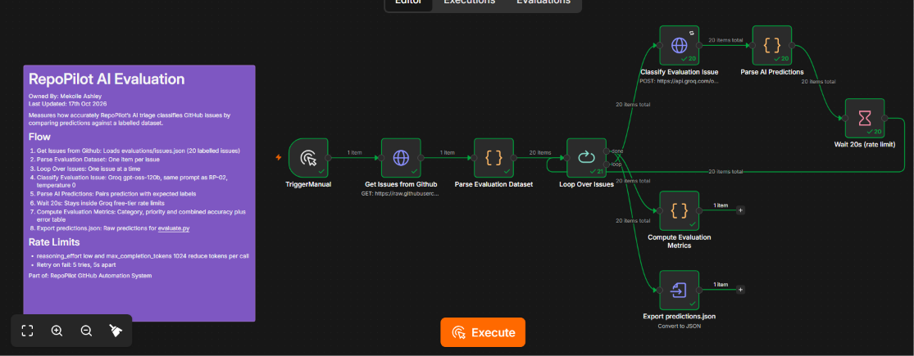
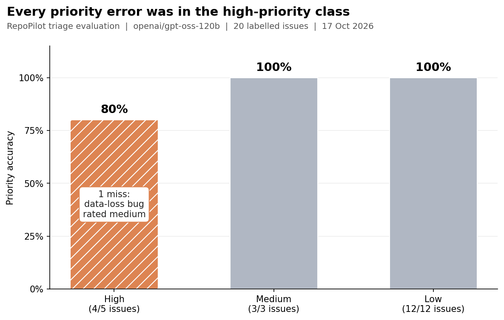

# RepoPilot AI Evaluation

How accurately does RepoPilot's AI triage classify GitHub issues? This evaluation measures it against a labelled test set instead of relying on a few manual spot checks.

## Objective

Measure how often RepoPilot's issue triage (RP-02) assigns the correct **category** (`bug`, `feature`, `documentation`, `needs-review`) and **priority** (`high`, `medium`, `low`) when compared with labels set by a human.

## Dataset

[`issues.json`](issues.json) contains 20 realistic GitHub issues. Each one has a title, a body, and the expected category and priority. The set deliberately includes:

- Clear-cut bugs, feature requests and documentation fixes
- High-priority cases: security risks, data loss and outages
- Vague or ambiguous reports that should be classified `needs-review`

## Method

| Setting | Value |
|---|---|
| Model | `openai/gpt-oss-120b` on Groq |
| Prompt | Same system prompt as RP-02 Issue Triage |
| Temperature | 0, for repeatable results |
| Output | JSON mode: category, priority, labels and reason |
| Scoring | Exact match after normalizing case and whitespace |

**Pipeline**

1. The n8n workflow [`RepoPilot_AI_Evaluation.json`](RepoPilot_AI_Evaluation.json) loads `issues.json` from this repo.
2. Each issue is classified one at a time, with a 20-second pause between calls to stay within Groq's free-tier rate limits.
3. Predictions are paired with the expected labels and exported to [`predictions.json`](predictions.json).
4. Accuracy is calculated in the workflow and independently by [`evaluate.py`](evaluate.py), so the two can be cross-checked.

## Results

| Metric | Score |
|---|---|
| Issues evaluated | 20 / 20 |
| Category accuracy | **100%** (20 / 20) |
| Priority accuracy | **95%** (19 / 20) |
| Category and priority both correct | **95%** (19 / 20) |

Run on 17 October 2026 with `openai/gpt-oss-120b` on Groq.

### Breakdown

| Expected priority | Issues | Correct | Accuracy |
|---|---|---|---|
| High | 5 | 4 | 80% |
| Medium | 3 | 3 | 100% |
| Low | 12 | 12 | 100% |

| Expected category | Issues | Correct |
|---|---|---|
| Bug | 8 | 8 |
| Feature | 5 | 5 |
| Documentation | 5 | 5 |
| Needs review | 2 | 2 |

The labels applied to GitHub matched the predicted category and priority in all 20 cases, so the labels on GitHub always agreed with the classification.

### Misclassified issues

| ID | Issue | Expected | Predicted | Model reasoning |
|---|---|---|---|---|
| 8 | Application deletes saved records | bug / high | bug / medium | The issue reports loss of saved records after an update, indicating a functional bug affecting data integrity. |

## Findings

**Category classification is reliable.** The model identified the type of every issue correctly, including the ambiguous reports that should go to `needs-review`.

**The only error is in the most important class.** All 15 low and medium issues were rated correctly, but high priority was right only 4 out of 5 times (80%). Overall accuracy hides this, which is why the breakdown matters. Issue 8, the one miss, describes saved records being deleted, which is data loss. The prompt explicitly defines data loss as `high` priority. The model's own reasoning shows it recognised the data loss, yet it still chose `medium`. So the model understood the issue but applied the priority rule too cautiously.

In a triage system, under-prioritising a severe issue costs more than over-prioritising a minor one. A data-loss bug labelled `medium` can sit in the backlog while users keep losing data, so this is the error worth fixing first.

**Likely cause:** the prompt tells the model to classify *conservatively*. That instruction helps for categories, where it pushes unclear issues to `needs-review`, but it seems to also pull priorities down.

**Proposed fix:** state that any confirmed or reported loss or deletion of user data is always `high`, whatever the tone of the report, and limit the "conservative" instruction to category only. Then re-run this evaluation to confirm the fix works and that nothing else has changed.

## Limitations

- **Small dataset:** 20 issues gives a useful signal, but each issue moves accuracy by 5 percentage points.
- **Unbalanced priorities:** 12 of the 20 issues are low priority and only 5 are high, so the class that matters most has the fewest examples.
- **One labeller:** the expected labels reflect one person's judgment. Borderline priorities, such as medium versus high, are partly subjective.
- **Exact match only:** a prediction one priority level away counts as fully wrong.
- **Possibly too easy for categories:** 100% category accuracy suggests most test issues are clear-cut. A harder set with more borderline cases would test the model more.

## Next steps

- Apply the data-loss priority fix to RP-02 and re-run the evaluation
- Grow the dataset to 50+ issues, with more borderline cases
- Compare other models and prompt versions against this baseline
- Re-run the evaluation after every prompt change to catch regressions
